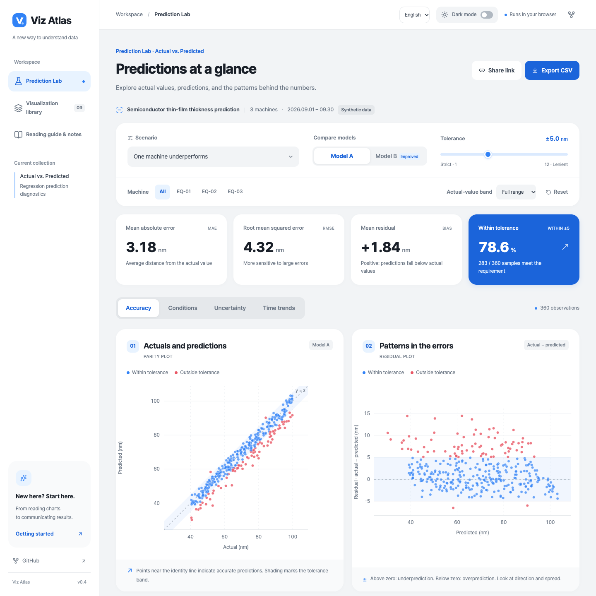
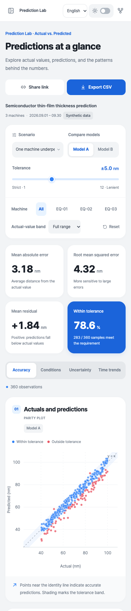

# Viz Atlas

[한국어](README.md) · **English**

**A visualization atlas for seeing, understanding, and explaining prediction results.**

An interactive React lab for actual vs. predicted values. Go beyond one average metric to explore where errors grow, which samples a new model improves, and how reliable prediction intervals are. Use it for presentations, visualization references, or hands-on practice interpreting model results.

[](https://github.com/gnuinu/viz-atlas/actions/workflows/deploy.yml)

**[Open the English demo →](https://gnuinu.github.io/viz-atlas/?lang=en)** · [Visualization library](https://gnuinu.github.io/viz-atlas/?lang=en#patterns) · [Reading guide & notes](https://gnuinu.github.io/viz-atlas/?lang=en#guide)



> **Prediction Lab** uses synthetic semiconductor thin-film thickness predictions. All observations and model outputs are reproducible educational simulations, not real manufacturing data or measured model performance.

## Explore the scenarios

| Question                             | Demo                                                                                                                       | Look for                                        |
| ------------------------------------ | -------------------------------------------------------------------------------------------------------------------------- | ----------------------------------------------- |
| What do good predictions look like?  | [Balanced](https://gnuinu.github.io/viz-atlas/?lang=en&scenario=balanced&view=diagnostics#lab)                             | Points near y=x and residuals centered on zero  |
| Does high correlation mean accuracy? | [Overprediction](https://gnuinu.github.io/viz-atlas/?lang=en&scenario=bias&view=diagnostics#lab)                           | Shifted points and negative residuals           |
| Do errors grow with actual values?   | [Heteroscedasticity](https://gnuinu.github.io/viz-atlas/?lang=en&scenario=hetero&view=diagnostics#lab)                     | A fan-shaped residual distribution              |
| What does the average hide?          | [One machine underperforms](https://gnuinu.github.io/viz-atlas/?lang=en&scenario=equipment&view=comparison#lab)            | EQ-03 errors and matched A/B improvements       |
| Are narrow intervals trustworthy?    | [Overconfident intervals](https://gnuinu.github.io/viz-atlas/?lang=en&scenario=overconfident&model=A&view=uncertainty#lab) | Target vs. observed coverage and interval width |
| Does performance hold over time?     | [Drift](https://gnuinu.github.io/viz-atlas/?lang=en&scenario=drift&view=time#lab)                                          | Late-period bias and daily error changes        |

## Choose a visualization

| Technique                          | Question                                                   |
| ---------------------------------- | ---------------------------------------------------------- |
| Actual vs. Predicted / Parity Plot | Do predictions agree with actual values?                   |
| Residual Plot                      | Are errors biased or dependent on value range?             |
| Grouped Box Plot                   | How do residual distributions differ by machine?           |
| Error ECDF                         | What share of predictions falls within a chosen tolerance? |
| Prediction Intervals               | Do intervals cover actual values, and at what width?       |
| Performance over Time              | When does performance change?                              |
| Conditional Error Heatmap          | Which machine × actual-value conditions have large errors? |
| Paired Model Improvement           | Which matched samples improve or worsen with model B?      |
| Interval Calibration               | Does observed coverage match the target?                   |

## Features

- Six scenarios, model A/B comparison, machine and actual-value band filters, and adjustable tolerance.
- Linked sample selection and keyboard-accessible sample lists.
- A/B heatmaps with a shared color range and matched comparisons using `|error A| − |error B|`.
- Overall and machine-level interval calibration at 50/70/80/90/95% targets.
- Shareable URLs and CSV exports of all currently filtered evaluation samples.
- Korean and English menus, scenarios, charts, tooltips, accessible labels, library, and reading guide.
- Light/dark themes, responsive layouts, light print styles, and reduced-motion support.

Use the header language selector to switch between **한국어** and **English**. Your choice is saved in browser storage and synchronized across tabs. A shared URL with `lang=en` or `lang=ko` takes precedence over the saved preference. Switching languages preserves analysis conditions, selected samples, theme, metrics, and CSV content. Language changes also work when browser storage is restricted.

<p align="center">
  
</p>

Screenshots show the actual v0.4.0 app. [Capture instructions](docs/SCREENSHOTS.md) include a script for regenerating Korean and English images.

## Run locally

Node.js 24 LTS is recommended; minimum version: 22.12.

```bash
git clone https://github.com/gnuinu/viz-atlas.git
cd viz-atlas
nvm install
nvm use
npm ci
npm run dev
```

Open `http://127.0.0.1:5173/viz-atlas/?lang=en`.

```bash
npm run check                   # Unit tests, TypeScript, and production build
npx playwright install chromium
npm run test:e2e                 # Browser interactions, languages, and mobile layouts
npm run preview                 # Preview the production build
```

With Chrome already installed, use `PW_CHROME=1 npm run test:e2e`.

## Data and interpretation

- 360 test observations: 3 machines × 120 samples, over 30 days in September 2026.
- Units: nm. **Residual = actual − predicted**; positive means underprediction.
- Fixed seeds preserve actual values and sample identities across models and scenarios.
- 240 separate calibration samples determine symmetric split-conformal intervals using the finite-sample rank `ceil((n+1) × target coverage)`.
- Calibration uses all machines. Filters change evaluation samples, without recalibration by machine or actual-value band. Marginal coverage does not imply conditional group coverage.
- In the overconfident scenario, model A uses 35% of the calibrated half-width. A/B point predictions are identical.
- Drift can break exchangeability; the demo does not claim a 90% guarantee in that scenario.
- Box whiskers end at observed values within 1.5 IQR of Q1/Q3; individual observations remain visible.
- Interval charts show up to 36 evenly selected samples sorted by prediction; metrics use all filtered samples.
- Heatmap cells with fewer than 15 samples carry a demo caution marker, not a statistical significance threshold.
- Actual-value bands are retrospective diagnostics. Actual values are unavailable at prediction time, so bands cannot directly define production model-selection rules.

This project does not include trained models, real manufacturing data, CSV uploads, or rolling-origin validation. Simulated improvements do not establish causality or significant real-world gains.

## Implementation and deployment

React 19 · TypeScript · Vite 8 · D3 scales/shapes · Lucide · Vitest · Playwright. The app generates and evaluates data in the browser with no backend. Pretendard Variable loads from jsDelivr with system-font fallbacks.

`src/i18n.tsx` manages language, URL settings, browser storage, and the React translation context. `src/translations.ts` contains English translations of Korean source messages with numeric interpolation placeholders. Analysis data keys remain independent of display language.

The independent visual theme references Toss’s [color-system design](https://toss.tech/article/43385) and [typography](https://tossmini-docs.toss.im/tds-mobile/foundation/typography/). Viz Atlas uses its own SVG logo and the openly licensed [Pretendard](https://github.com/orioncactus/pretendard) font.

GitHub Pages uses Vite base `/viz-atlas/`, hash navigation, and query settings. `.github/workflows/deploy.yml` runs tests, builds, verifies browser behavior, and deploys pushes to `main`. Pull requests run validation only. Configure **Settings → Pages → Source: GitHub Actions** when setting up another repository.

## References and contributions

- [scikit-learn: PredictionErrorDisplay](https://scikit-learn.org/stable/modules/generated/sklearn.metrics.PredictionErrorDisplay.html)
- [Evidently: Regression evaluation](https://docs.evidentlyai.com/metrics/preset_regression)
- [MAPIE: Conformal prediction](https://mapie.readthedocs.io/en/stable/)
- [Forecasting: Principles and Practice](https://otexts.com/fpp3/toolbox.html)

Suggest techniques, interpretation improvements, or bugs through [Issues](https://github.com/gnuinu/viz-atlas/issues). Include the scenario, browser, and a reproducible shared URL. New visualizations should explain their question, calculation, interpretation, and limitations. Update both languages and relevant screenshots when changing the interface.
