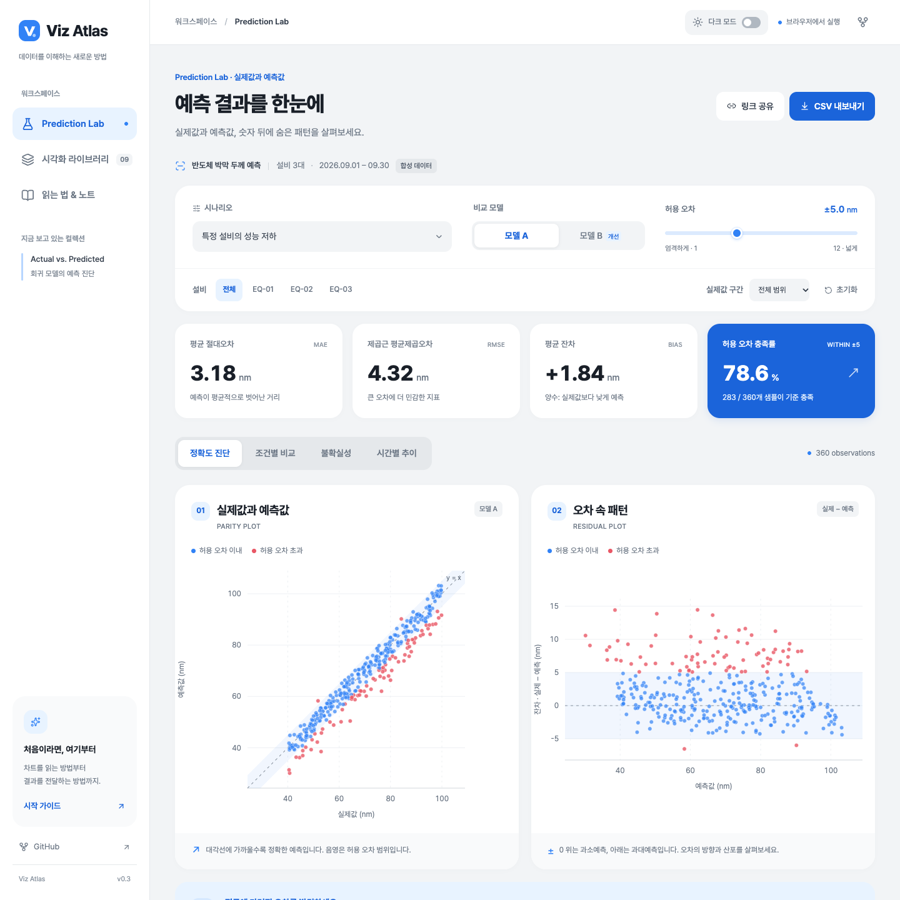
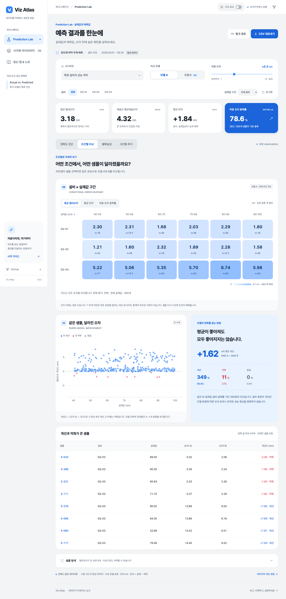
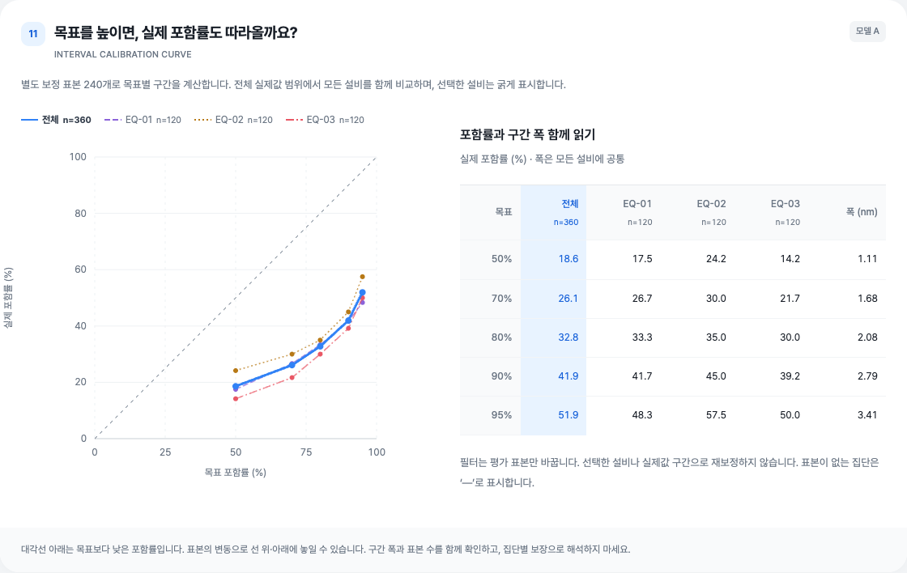
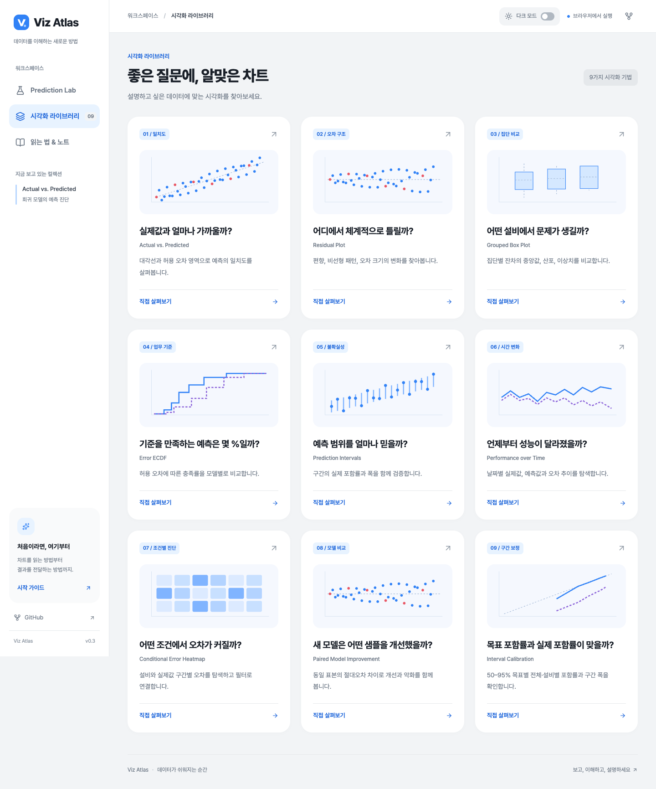
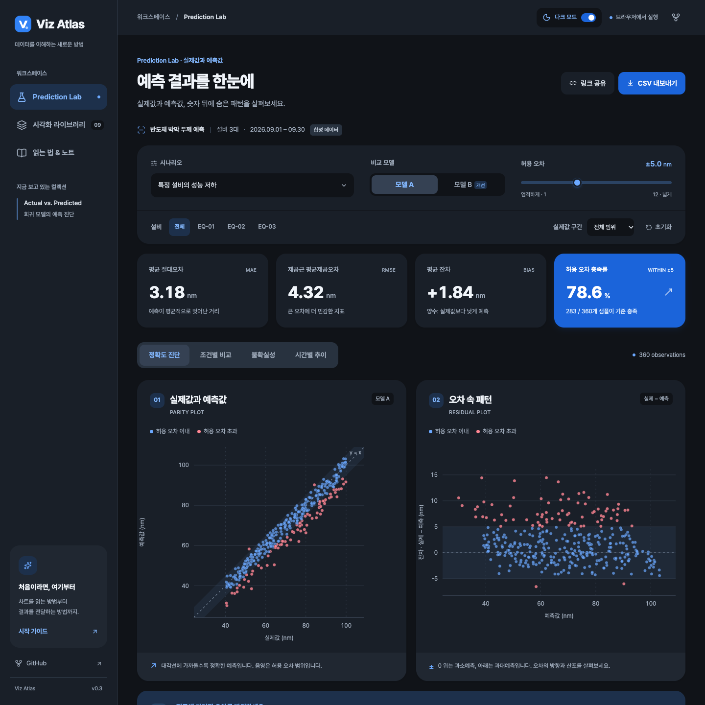
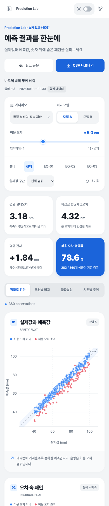

# Viz Atlas

**예측 결과를 보고, 이해하고, 설명하는 데이터 시각화 아틀라스.**

실제값과 예측값을 비교하는 React 실험실입니다. 하나의 평균 지표를 넘어 **어디에서 오차가 커지는지, 새 모델이 무엇을 개선했는지, 예측 구간을 얼마나 믿을 수 있는지** 직접 탐색합니다. 발표용 데모, 시각화 기법 참고 자료, 예측 결과 해석 연습에 활용할 수 있습니다.

[](https://github.com/gnuinu/viz-atlas/actions/workflows/deploy.yml)


**[라이브 데모 →](https://gnuinu.github.io/viz-atlas/)** · [시각화 라이브러리](https://gnuinu.github.io/viz-atlas/#patterns) · [읽는 법 & 노트](https://gnuinu.github.io/viz-atlas/#guide)



> 첫 컬렉션 **Prediction Lab**은 가상의 반도체 박막 두께 예측을 다룹니다. 모든 데이터와 모델 예측은 재현 가능한 교육용 합성 데이터이며 실제 제조 성능을 나타내지 않습니다.

## 빠르게 둘러보기

설치 없이 데모를 열고 아래 순서로 살펴보세요. 각 링크는 해당 분석 조건으로 바로 이동합니다.

| 탐색할 질문                    | 데모                                                                                                     | 살펴볼 내용                                     |
| ------------------------------ | -------------------------------------------------------------------------------------------------------- | ----------------------------------------------- |
| 좋은 예측은 어떤 모양일까?     | [균형 잡힌 예측](https://gnuinu.github.io/viz-atlas/?scenario=balanced&view=diagnostics#lab)             | 기울기 1의 기준선과 0을 중심으로 퍼진 잔차      |
| 상관관계가 높으면 정확할까?    | [일정한 과대예측](https://gnuinu.github.io/viz-atlas/?scenario=bias&view=diagnostics#lab)                | 대각선에서 이동한 점과 음수 잔차                |
| 큰 값에서도 오차가 같을까?     | [이분산](https://gnuinu.github.io/viz-atlas/?scenario=hetero&view=diagnostics#lab)                       | 실제값이 커질수록 넓어지는 잔차 분포            |
| 평균이 놓친 조건은 무엇일까?   | [특정 설비의 성능 저하](https://gnuinu.github.io/viz-atlas/?scenario=equipment&view=comparison#lab)      | EQ-03의 오차와 같은 표본에 대한 모델 A/B 개선도 |
| 좁은 예측 구간은 믿을 만할까?  | [과신하는 구간](https://gnuinu.github.io/viz-atlas/?scenario=overconfident&model=A&view=uncertainty#lab) | 목표 포함률과 실제 포함률, 구간 폭의 관계       |
| 시간이 지나도 성능이 유지될까? | [시간에 따른 성능 저하](https://gnuinu.github.io/viz-atlas/?scenario=drift&view=time#lab)                | 평가 후반의 편향과 일별 오차 변화               |

## 화면으로 보는 주요 기능

### 조건별 오차와 모델 개선도

설비 × 실제값 구간의 히트맵에서 문제 조건을 찾고, 같은 표본의 모델 A/B 오차를 비교합니다. 셀을 선택하면 다른 차트와 지표, CSV에도 동일한 필터가 적용됩니다.



### 예측 구간의 신뢰도

50·70·80·90·95% 목표 포함률을 실제 포함률과 비교합니다. 과신 시나리오는 점 예측을 그대로 두고 구간만 좁혀, 정확도와 불확실성을 구분해 살펴볼 수 있도록 구성했습니다.



### 질문에서 출발하는 시각화 라이브러리

9개의 시각화 패턴을 질문·미리보기·설명으로 정리했습니다. 카드를 누르면 해당 기법을 실험할 수 있는 분석 화면으로 이동합니다.



### 라이트·다크 테마와 모바일

첫 방문에는 시스템 테마를 따르며 직접 선택한 테마는 브라우저에 저장됩니다. 차트, 히트맵, 표, 가이드까지 테마가 적용되고 모바일에서도 동일한 분석 기능을 사용할 수 있습니다.



<p align="center">
  
</p>

캡처는 실제 앱 v0.3.0 화면입니다. 재생성 방법은 [캡처 안내](docs/SCREENSHOTS.md)에 정리했습니다.

## 어떤 차트를 고를까?

| 기법                               | 답하려는 질문                            | 함께 확인할 것                          |
| ---------------------------------- | ---------------------------------------- | --------------------------------------- |
| Actual vs. Predicted / Parity Plot | 실제값과 예측값이 일치하는가?            | `y = x` 기준선, 같은 축 단위, 허용 오차 |
| Residual Plot                      | 오차가 특정 방향이나 범위에 몰리는가?    | 잔차의 부호, 편향, 부채꼴 분포          |
| Grouped Box Plot                   | 설비별 오차 분포가 다른가?               | 중앙값·산포·개별 표본                   |
| Error ECDF                         | 어느 정도의 오차 안에 몇 %가 들어오는가? | 허용 오차 위치와 A/B 누적 비율          |
| Prediction Intervals               | 실제값을 구간이 얼마나 포함하는가?       | 관측 포함률과 구간 폭                   |
| Performance over Time              | 성능이 언제 바뀌는가?                    | 일별 MAE·평균 잔차와 표본 수            |
| Conditional Error Heatmap          | 어떤 조건에서 오차가 커지는가?           | 설비·실제값 구간, 셀별 표본 수          |
| Paired Model Improvement           | 새 모델이 어떤 표본을 개선·악화하는가?   | 동일 표본 매칭과 개선·악화 양쪽 끝      |
| Interval Calibration               | 목표 포함률과 실제 포함률이 맞는가?      | 전체·설비별 곡선과 구간 폭              |

## 탐색과 공유

- **분석 조건**: 6개 시나리오, 모델 A/B, 설비, 실제값 구간, 허용 오차를 변경합니다.
- **연결된 선택**: 차트와 샘플 목록에서 같은 표본을 강조하며 키보드로도 조작할 수 있습니다.
- **공유 URL**: 분석 탭과 조건을 주소에 보존하므로 같은 상태를 다시 열 수 있습니다.
- **CSV**: 현재 필터의 전체 평가 데이터를 실제값·예측값·잔차·90% 예측 구간과 함께 내보냅니다.
- **해석 가이드**: 결과를 설명하는 순서, 계산 기준, 주의할 해석과 참고 자료를 제공합니다.
- **화면 대응**: 모바일, 밝은 인쇄 스타일, 동작 감소 설정을 지원합니다.

## 새 진단 사용하기

1. **조건별 비교** 탭에서 히트맵의 셀을 선택합니다. 설비·실제값 구간이 다른 차트, 지표, CSV에도 적용됩니다. 같은 셀을 다시 누르면 전체로 돌아갑니다.
2. 아래 산점도에서 `|오차 A| − |오차 B|`를 확인합니다. 양수는 B가 개선한 표본, 음수는 악화한 표본입니다. 평균 개선도는 MAE A − MAE B와 같습니다.
3. **불확실성** 탭 아래의 보정 곡선에서 목표 포함률과 관측된 포함률을 비교합니다. 선택한 설비를 강조하면서 다른 설비도 함께 보여 줍니다. 구간 폭 표로 과도하게 넓은 구간인지 확인합니다.

히트맵은 선택 후에도 전체 조건 지도를 유지하고 A/B 공통 색 범위를 사용합니다. 보정 곡선 역시 설비 전체를 비교하며, 실제값 구간 필터만 평가 표본을 좁힙니다. 표본이 15개 미만인 셀의 † 표시는 데모용 주의 표시이며 통계적 유의성 기준이 아닙니다. 실제값 구간은 관측 이후의 진단에 사용하며 운영 시 모델 선택 규칙으로 바로 사용할 수 없습니다.

## 디자인

토스의 [컬러 시스템 설계](https://toss.tech/article/43385)와 [타이포그래피](https://tossmini-docs.toss.im/tds-mobile/foundation/typography/)를 참고한 독립 테마입니다. 파란색 강조, 밝은 회색 배경, 넓은 여백과 둥근 카드로 시각적 위계를 구성했습니다. 글꼴은 공개 라이선스의 [Pretendard](https://github.com/orioncactus/pretendard)를 사용하며, 로고는 Viz Atlas 자체 SVG입니다.

`src/styles.css`의 의미별 CSS 변수로 버튼·선택 상태·차트 색상을 관리합니다. 정확도 산점도는 파랑으로 허용 범위 이내, 빨강으로 범위 초과를 나타냅니다. 모델과 설비를 구분하는 차트에는 범례·선 모양·수치를 함께 제공합니다.

다크모드는 배경뿐 아니라 차트·히트맵·표·가이드에 모두 적용됩니다. 공유 URL의 분석 조건과 테마 설정은 독립적이며, 인쇄 시에는 밝은 테마를 사용합니다. 브라우저가 저장소 사용을 제한해도 현재 화면의 테마는 전환할 수 있습니다.

## 로컬 실행

Node.js 24 LTS 권장 (최소 22.12). 저장소를 처음 받는 경우:

```bash
git clone https://github.com/gnuinu/viz-atlas.git
cd viz-atlas
nvm install
nvm use
npm ci
npm run dev
```

개발 주소: http://127.0.0.1:5173/viz-atlas/

```bash
npm run check       # 통계·데이터 테스트와 TypeScript/프로덕션 빌드
npx playwright install chromium
npm run test:e2e    # 실제 브라우저 상호작용과 모바일 검증
npm run preview    # 프로덕션 빌드 미리보기
```

Chrome이 설치된 로컬 환경에서는 `PW_CHROME=1 npm run test:e2e`로 설치된 Chrome을 사용할 수 있습니다.

## 기술 구성

React 19 · TypeScript · Vite 8 · D3 scales/shapes · Lucide · Vitest · Playwright.

백엔드 없이 브라우저에서 데이터를 생성하고 평가합니다. Pretendard Variable 웹 폰트를 jsDelivr에서 불러오며 실패하면 시스템 폰트를 사용합니다. CSV 업로드나 외부 데이터 저장 기능은 없습니다.

```text
src/
  App.tsx          # 앱, 탐색 설정, 라이브러리와 가이드
  Charts.tsx       # 반응형 SVG 차트와 연결된 선택
  ChartCard.tsx    # 공통 차트 카드
  AdvancedDiagnostics.tsx # 히트맵, 모델 개선도, 보정 곡선
  diagnostics.ts   # 조건별 필터, 표본 매칭, 목표별 포함률
  diagnostics.test.ts # 구간 경계, 동일 표본 비교, 평가 데이터 분리 검증
  data.ts          # 합성 데이터, 통계, 예측 구간, URL/CSV
  data.test.ts     # 통계·시나리오 검증
  useTheme.ts      # 시스템 테마, 저장 및 다른 탭과 동기화
  styles.css       # 라이트·다크 테마와 반응형 스타일
tests/app.spec.ts  # 브라우저 동작 테스트
scripts/capture-docs.mjs # README 화면 캡처
docs/images/       # 실제 앱 캡처
```

## 데이터와 해석

- 평가: 설비 3대 × 120개 = 360개 표본. 2026년 9월 30일, 일별 12개.
- 단위: nm. 잔차는 **실제 − 예측**으로 통일합니다.
- 같은 샘플의 실제값과 잡음 시드를 유지해 시나리오/모델을 비교합니다.
- 240개 독립 보정 표본으로 split-conformal 방식의 대칭 90% 예측 구간을 계산합니다. 보정은 모든 설비를 사용하며 필터는 평가 대상만 바꿉니다.
- 보정 곡선은 같은 별도 보정 표본의 유한 표본 보정 분위수로 목표별 폭을 계산합니다. 설비·실제값 구간별로 재보정하지 않습니다. 집단별 포함률 보장은 없으며 유한 평가 표본의 변동도 고려해야 합니다.
- 과신 시나리오는 모델 A의 구간 반폭을 35%로 축소합니다. 모델 B와 점 예측은 동일합니다.
- 시간 변화 시나리오는 보정 이후 평가 후반에 편향을 넣습니다. 이때 교환가능성 가정이 깨질 수 있어 90% 포함을 보장하지 않습니다.
- 박스 수염은 Q1/Q3에서 1.5 IQR 이내 실제 관측값까지이며, 모든 점을 함께 표시합니다.
- 예측 구간 차트에는 예측값으로 정렬한 평가 샘플에서 고르게 뽑은 최대 36개만 표시하지만 지표는 필터된 전체 표본으로 계산합니다.

실제 학습 모델, 진짜 제조 데이터, 미래 시계열 예측의 rolling-origin 검증은 포함하지 않습니다. 시나리오 B의 ‘개선’ 표시는 시뮬레이션 설계이며 실증 성능 주장이 아닙니다.

## GitHub Pages

Vite의 `base`는 `/viz-atlas/`입니다. 해시 탐색과 쿼리 설정을 사용하므로 공유 링크를 새로고침해도 Pages에서 작동합니다.

`.github/workflows/deploy.yml`은 `main` push 시 테스트 → 빌드 → 브라우저 테스트 → Pages 배포를 실행합니다. Pull request에서는 검증만 수행합니다. 저장소 **Settings → Pages → Source: GitHub Actions** 설정이 필요합니다.

## 참고 자료

- [scikit-learn: PredictionErrorDisplay](https://scikit-learn.org/stable/modules/generated/sklearn.metrics.PredictionErrorDisplay.html)
- [Evidently: Regression evaluation](https://docs.evidentlyai.com/metrics/preset_regression)
- [MAPIE: Conformal prediction](https://mapie.readthedocs.io/en/stable/)
- [Forecasting: Principles and Practice](https://otexts.com/fpp3/toolbox.html)

## 다음 확장

CSV 입력과 스키마 검증, 실제 공개 데이터의 모델 학습 예제, 예측 거리별 시계열 평가, 이미지/SVG 내보내기 등을 독립 컬렉션으로 확장할 수 있습니다.

## 기여와 피드백

추가로 보고 싶은 시각화, 해석 개선, 버그 제안은 [Issues](https://github.com/gnuinu/viz-atlas/issues)에 남겨 주세요. 화면 문제는 시나리오·분석 탭·브라우저와 재현 가능한 공유 URL을 함께 적으면 확인하기 쉽습니다.

새 기법을 추가할 때는 차트뿐 아니라 **답하려는 질문, 계산 기준, 해석 예시와 한계**를 함께 작성해 주세요. 기능 변경 시 `npm run check`와 해당 브라우저 동작을 검증하고, 화면이 달라지면 문서 캡처도 갱신합니다.
